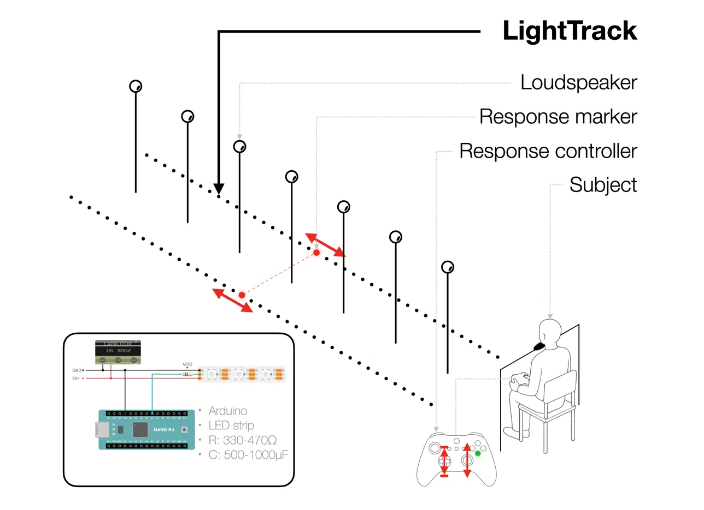
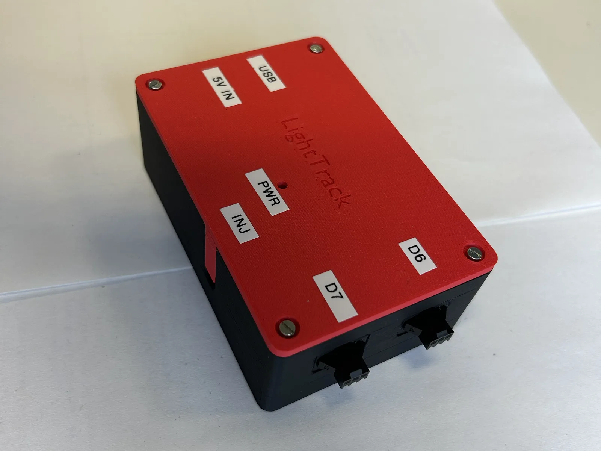
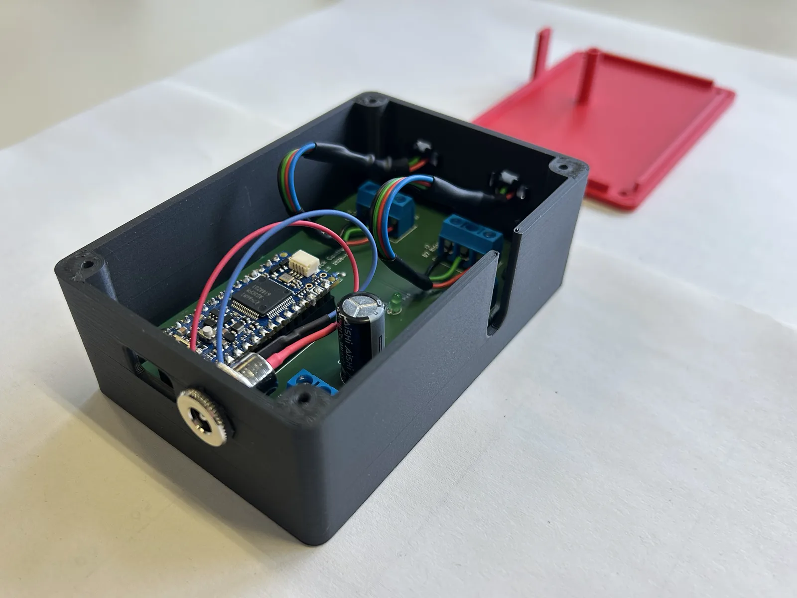
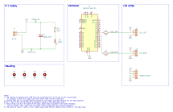

# LightTrack

**LightTrack** is a simple, Arduino-controlled LED response track for behavioural and psychophysics experiments.

<p align="center"></p>

The original prototype was developed for auditory distance-estimation experiments at Leipzig University's [Neurobiology Group](https://www.lw.uni-leipzig.de/en/institut-fuer-biologie/abteilungen/general-zoology-and-neurobiology/research). Participants moved a red marker along two floor-mounted LED strips with an Xbox controller and pressed A to confirm their response. The system was later further developed at TU Berlin's [Audio Communication Group](https://www.tu.berlin/ak) for another auditory distance experiment at the [Faculty of Media Sciences](https://www.hs-mittweida.de/en/about-us/faculty-media-sciences/) of Mittweida University of Applied Sciences.

<p align="center">
  
  
</p>

<p align="center"><em>The LightTrack controller: an Arduino Nano R4 on a small carrier board, housed in a 3D-printed enclosure.</em></p>

---

## Files

The implementation is intentionally small:

Python keeps track of the participant's current response, converts that distance to the nearest LED position, and sends the corresponding command to an Arduino. The Arduino only controls the LED strips.

- `lighttrack.py` - Python interface to the response track
- `lighttrack/lighttrack.ino` - Arduino firmware
- `experiment_example.py` - small auditory distance-estimation example
- `experiment_mittweida.py` - auditory distance experiment that sends the responses via OSC
- `quicktest.py` - checks the connection, the controller and the LEDs
- `requirements.txt` - Python dependencies
- `hardware/pcb-board/` - KiCad 10 schematic and PCB of the controller board
- `hardware/enclosure/` - Blender model of the controller enclosure

---

## Wiring

The default Arduino pins in `lighttrack/lighttrack.ino` are:

```cpp
LEFT_PIN = 6
RIGHT_PIN = 7
```

The two strips should be installed in the **same direction**, with LED 0 at the start of the response track.

Wiring of the controller board (`hardware/pcb-board/`):

<p align="center"></p>

In the assembled controller, the panel-mount DC jack is wired to J1; J2 and J3 lead to the two JST sockets in the enclosure wall; J4 is reachable through the slot in the wall for power injection.

The Arduino and the LED power supply must share a **common ground**.

Do not power a long LED strip from the Arduino itself. Use an external regulated 5 V power supply. For long physical installations, power may need to be supplied at more than one point along the strip. Power injection is provided on the PCB.
In our tests with two 20 m strips (30 LEDs/m), power injection was not needed.

---

## Arduino setup

1. Install the [Arduino IDE](https://www.arduino.cc/en/software).
2. Install the [Adafruit NeoPixel library](https://github.com/adafruit/Adafruit_NeoPixel).
3. Open `lighttrack/lighttrack.ino`.
4. Check that `LEFT_PIN` and `RIGHT_PIN` match your wiring.
5. Upload the sketch to the Arduino.

### Command line alternative

With [arduino-cli](https://arduino.github.io/arduino-cli/) installed, the `Makefile` builds and flashes the firmware.
The board core and library versions in `lighttrack/sketch.yaml` are installed automatically on the first build.

```bash
make compile   # build only
make upload    # build and flash (port is auto-detected, or pass PORT=/dev/cu.usbmodem101)
make monitor   # serial monitor at 115200 baud
make flash     # upload, then open the serial monitor
make ports     # list connected boards
```

The Arduino does not need to know the physical distance range. Python sends the required number of LED positions when it connects.

---

## Python setup

Install the required packages:

```bash
pip install -r requirements.txt
```

The main LightTrack settings are defined in metres:

```python
from lighttrack import LightTrack

track = LightTrack(
    port="COM5",
    start_m=1,
    end_m=13,
    leds_per_m=30,
)
```

On macOS or Linux, the serial port may look more like:

```python
port="/dev/cu.usbmodem101"
```

### Basic use

```python
track.show(7.0)       # red marker at approximately 7 m
track.confirm()       # current marker turns green

track.clear()
track.close()
```

The experimenter never needs to work directly with LED numbers.

For example, with:

```python
start_m = 1
end_m = 13
leds_per_m = 30
```

LightTrack automatically maps:

```text
1 m   -> beginning of the track
7 m   -> middle of the track
13 m  -> end of the track
```

If a requested position falls between two LEDs, the nearest physical LED is used.

---

## Quick test

`quicktest.py` checks that the connection, the controller and the LEDs work.
The serial port, the track length and the marker speed are set at the top of the script.

```bash
python quicktest.py
```

What it does:

1. connects to LightTrack (1 m to 20 m, 30 LEDs/m);
2. uses the first controller pygame finds.
   Without a controller it opens a small window and uses the keyboard: the Up and Down arrows act like the joystick, Space acts like A;
3. shows a red marker in the middle of the track.
   The joystick (or the arrow keys) moves it continuously, the D-pad moves it in 0.1 m steps;
4. A (or Space) turns the marker green to confirm the position.
   It turns red again as soon as the marker moves.

The script prints the controller name, every position where the marker stops and every confirmed position.
Stop it with Ctrl+C in the terminal or by closing the pygame window.
The LEDs are switched off when the script stops.

Check that:

- both strips show a single marker;
- both markers indicate the same physical position;
- the marker moves in the expected direction;
- confirmation changes the marker to green.

---

## Troubleshooting

### No LEDs turn on

Check:

- the external 5 V supply;
- common ground between Arduino and LED supply;
- LED strip `DIN` rather than `DOUT`;
- Arduino serial port;
- whether `lighttrack/lighttrack.ino` was uploaded successfully.

### Arduino connects, but LEDs do not respond

Check:

- the data wires from J2 (left strip, D6) and J3 (right strip, D7) to each strip's `DIN`;
- the solder joints of the data line resistors R1 and R2;
- that the strip is WS2812B-compatible;
- that the Arduino and Python code both use 115200 baud.

### Only one strip works

Check the second strip's:

- data wire;
- 5 V connection;
- ground connection.

### Position does not match the physical track

Check:

```python
start_m
end_m
leds_per_m
```

Also verify where the first physical LED sits relative to the start of the distance scale.

### LEDs behave unreliably

Check the power wiring first: the 5 V supply at J1, the common ground and that C1 is fitted with the correct polarity.
Long strips may require additional power injection via J4.

---

## Parts list

This list contains all parts that are needed to build the LightTrack system. (This does NOT include any spare parts!)

| Qty                           | Part                                                 | What it does                                                                                                              | Example / helper                                                                                                                                                              |
| ----------------------------- | ---------------------------------------------------- | ------------------------------------------------------------------------------------------------------------------------- | ----------------------------------------------------------------------------------------------------------------------------------------------------------------------------- |
| 1                             | **Arduino Nano R4**                                  | Receives serial commands from Python and controls the LEDs                                                                | Version without headers (ABX00142) - soldering is fun.<br>If you order the one with preinstalled headers, you do not need to order the next part in this list                 |
| 2&nbsp;×&nbsp;15 pins         | **Pin headers, 2.54 mm**                             | Soldered to the Nano so it can be plugged into the socket strips                                                          | You can order longer strips and cut them to length                                                                                                                            |
| 2&nbsp;×&nbsp;15 pins         | **Female socket strips, 2.54 mm, 8.5 mm high**       | Hold the Nano on the PCB, so it can be swapped without desoldering                                                        | Same goes here                                                                                                                                                                |
| 1                             | **Controller PCB**                                   | Carrier board for the Nano, the resistors, the capacitor and all screw terminals                                          | Manufactured from the KiCad files in `hardware/pcb-board/`                                                                                                                    |
| 1&nbsp;+&nbsp;2&nbsp;+&nbsp;1 | **Screw terminals, 5.08 mm, 90°** (2-, 3- and 4-pin) | 5 V input (J1), left and right LED strip (J2, J3), power injection (J4)                                                   |                                                                                                                                                                               |
| 2                             | **470 Ω resistor**                                   | Series resistor in each LED data line (R1, R2)                                                                            |                                                                                                                                                                               |
| 1                             | **1.5 kΩ resistor**                                  | Current limit for the supply indicator LED (R3)                                                                           |                                                                                                                                                                               |
| 1                             | **3 mm green LED, low current (2 mA)**               | Shows that the 5 V LED supply is present (D1)                                                                             |                                                                                                                                                                               |
| 1                             | **1000 µF / 25 V electrolytic capacitor**            | Stabilises the LED supply (C1)                                                                                            |                                                                                                                                                                               |
| 1                             | **5 V / 4 A power supply**, 5.5 × 2.1 mm plug        | Powers the LED strips                                                                                                     | e.g. MEAN WELL GST25E05-P1J                                                                                                                                                   |
| 1                             | **Panel-mount DC jack**, 5.5 × 2.1 mm                | Power input in the enclosure wall, wired to J1                                                                            | Needs an 11 mm panel hole, solder lugs                                                                                                                                        |
| 4 pairs                       | **JST SM connectors, 3-pin**                         | Plug the LED strips into the enclosure via an adapter cable                                                               | SMP-03V-BC in the enclosure wall and on each strip, adapter cable with SMR-03V-B on both ends;<br>plus crimp contacts (3 × SHF-001T-0.8BS per SMP, 3 × SYM-001T-P0.6 per SMR) |
| 1                             | **3D-printed enclosure** (base + lid)                | Houses the controller PCB                                                                                                 | Print from the Blender project `lighttrack_enclosure.blend` in `hardware/enclosure/`                                                                                          |
| 8&nbsp;×&nbsp;5&nbsp;m        | **WS2812B LED strip, 30 LEDs/m**                     | Displays the response position: 4 rolls joined per strip, 2 strips of 20 m (600 LEDs each, 571 used for the 1-20 m track) | e.g. [example LED strip](https://www.adafruit.com/product/2537) - order as many as YOU need for your project                                                                  |
| 4                             | **M3 × 10 self-tapping screws**, pan head            | Hold the lid on the base                                                                                                  |                                                                                                                                                                               |
| 4                             | **M3 × 6 self-tapping screws**                       | Hold the PCB on the standoffs                                                                                             |                                                                                                                                                                               |
| 4                             | **Rubber feet**, self-adhesive, 10 mm diameter       | Fit the recesses on the enclosure underside                                                                               | (nice to have)                                                                                                                                                                |
| ~25 mm                        | **3 mm clear acrylic rod**                           | Light pipe from the supply LED to the lid                                                                                 | (nice to have)                                                                                                                                                                |
| as needed                     | **3-core cable** (+5 V, data, GND)                   | Making adapters and leads, e.g. from the strips' JST plugs to the enclosure and from the strips to the PCB terminals      | e.g. 3 × 0.75 mm², sized for the strip current                                                                                                                                |
| as needed                     | **Hookup wire**                                      | Power injection wiring                                                                                                    | Only needed for very long LED strips                                                                                                                                          |
| 1                             | **USB-C data cable**                                 | Connects the Arduino to the experiment computer                                                                           |                                                                                                                                                                               |
| 1                             | **Game controller**                                  | Participant input in the example                                                                                          | e.g. Xbox Wireless Controller, but check out the [pygame joystick docs](https://www.pygame.org/docs/ref/joystick.html) for supported controllers                              |

### Recommended Arduino

For a new build, a **compact 5 V Arduino** is the easiest option.

The [Arduino Nano R4](https://docs.arduino.cc/hardware/nano-r4/) is a good default because it combines a small Nano-format board with **5 V GPIO** and USB-C. This makes it convenient for a small portable interface and avoids the extra logic-level conversion normally needed when a 3.3 V controller drives a 5 V LED strip.

The original LightTrack prototype used an **Arduino Nano 33 IoT**. Its small size was useful for the same portability reasons, but it uses 3.3 V GPIO. If a 3.3 V board is used, a suitable logic-level shifter is recommended.

### LED strips

LightTrack is written for individually addressable WS2812B-style RGB strips.

The original system used **30 LEDs/m**, giving a physical response resolution of about:

```text
1 / 30 m = 3.3 cm
```

The Adafruit strip linked above is only an example. Equivalent 5 V WS2812B-compatible strips from other suppliers should work as well.

For general wiring and power guidance, the [Adafruit NeoPixel Überguide](https://learn.adafruit.com/adafruit-neopixel-uberguide) and its [best-practices page](https://learn.adafruit.com/adafruit-neopixel-uberguide/best-practices) are useful references.

---

## How LightTrack fits into other experiments

LightTrack itself does not depend on auditory experiments.

The same interface can be used wherever a participant needs to indicate a position along a physical scale:

```text
controller / keyboard / other input
                ↓
          experiment code
                ↓
       response in physical units
                ↓
            LightTrack
                ↓
             Arduino
                ↓
            LED marker
```

Python remains the central hub, so the input device and stimulus software can be replaced without changing the Arduino side.

---

## Useful links

- [Arduino Nano R4 documentation](https://docs.arduino.cc/hardware/nano-r4/)
- [Arduino Nano R4 official store](https://store.arduino.cc/products/nano-r4)
- [Arduino IDE](https://www.arduino.cc/en/software)
- [Adafruit NeoPixel 30 LEDs/m example strip](https://www.adafruit.com/product/2537)
- [Adafruit NeoPixel Überguide](https://learn.adafruit.com/adafruit-neopixel-uberguide)
- [NeoPixel best practices](https://learn.adafruit.com/adafruit-neopixel-uberguide/best-practices)
- [Adafruit NeoPixel Arduino library](https://github.com/adafruit/Adafruit_NeoPixel)
- [Xbox Wireless Controller](https://www.xbox.com/accessories/controllers/xbox-wireless-controller)
- [slab](https://github.com/DrMarc/slab)
- [slab documentation](https://slab.readthedocs.io/)
- [Original distance_anchoring experiment](https://github.com/SebSchroe/distance_anchoring)

---

## License

See `LICENSE`.
